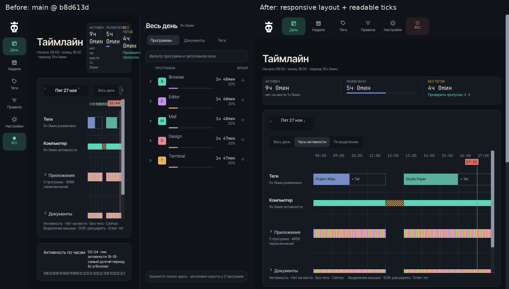
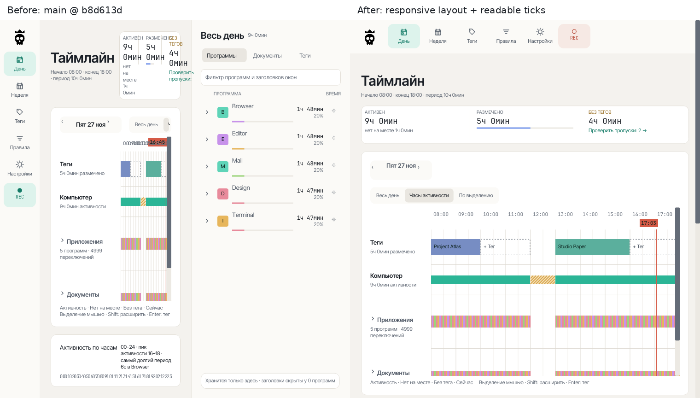
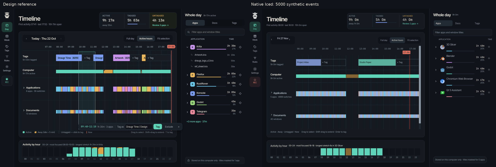
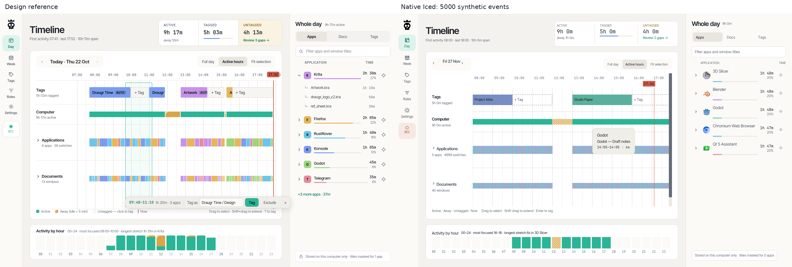

# M12 — approved UI audit and quality-of-life follow-up

This implements all six fixes and all four optional conveniences from the
2026-11-27 audit of `main` at `b8d613d`. It keeps the Iced/tiny-skia UI and existing
history model. There are no new dependencies, SQL migrations or network services.

| Item | Result |
| --- | --- |
| F1: intermediate window sizes and overlapping time labels | Derive the stacked shell from measured rail width, details width and 600 px of usable main content. Choose Day, Week and hourly label density from canvas width. Give the Now badge a separate ruler row. |
| F2: lost tag/rule drafts | Guard shared New/Select entry points, including suggested rules. Save, Discard and Stay retain the intended next action. Invalid saves keep the draft and dialog. Existing history-application confirmation still takes precedence. |
| F3: theme reset after restart | Atomically save System/Light/Dark in `ui.json` beside `language.json`, independently of the history folder. System continues following the OS. |
| F4: awkward search reset | Trim outer whitespace when matching. Show a clear button for a populated filter. Escape dismisses dialogs/menus first, then clears the filter before clearing the selection. |
| F5: shortcuts outside their screen | Date arrows/Today and Day zoom no longer change hidden state on Settings/Tags/Rules/Reports. Search targets existing fields; Week/Settings have no phantom activity-search target. |
| F6: Clippy failure | Iterate hourly bins with `enumerate`; the strict Clippy command succeeds on Rust 1.100.0. |
| Q1: jump to date | Click the Day/Week date to enter YYYY-MM-DD. Validate calendar dates in 1970–9999, confirm with Enter and cancel with Escape. Keep Today and previous/next navigation. |
| Q2: remember window size | Keep logical dimensions from resize events and save on close/quit or an explicit theme change. Fit reopened windows to Iced's monitor size with 48 px of headroom for decorations/panels. Leave position to the window manager, including Wayland. No new idle or resize timer. |
| Q3: open data folder/copy path | Settings → Data & import operates on the active folder and separately labels a folder pending the next launch. Folder paths are passed as one OS-command argument, without a shell. Opening runs off the UI thread and reports failures. |
| Q4: discoverable shortcut list | Settings → General has a Keyboard shortcuts button. Keep F1/? and make the list scroll at the minimum window height. |

All new interface strings are translated into English, Russian, German, French,
Spanish, Portuguese, Simplified Chinese and Japanese. Application Rust formatting
uses tabs, configured in `app/rustfmt.toml`; its separate formatting-only commit
can be hidden when reviewing the functional changes.

## Visual review

These are fresh Iced/tiny-skia renders of synthetic history, with bundled fonts.
The Day and Week regressions cover 480, 700, 759, 760, 900 and 1280 px in both
themes and English/Russian/German. Additional captures cover General, Data,
date jump, dirty drafts and shortcut help (600 px height for dialogs).

| Screen | Dark | Light |
| --- | --- | --- |
| Day, 1280×820 | [PNG](screenshots/qol/day-dark-1280x820.png) | [PNG](screenshots/qol/day-light-1280x820.png) |
| Day, 760×820 | [PNG](screenshots/qol/day-dark-760x820.png) | [PNG](screenshots/qol/day-light-760x820.png) |
| Day, 480×820 | [PNG](screenshots/qol/day-dark-480x820.png) | [PNG](screenshots/qol/day-light-480x820.png) |
| Week, 760×820 | [PNG](screenshots/qol/week-dark-760x820.png) | [PNG](screenshots/qol/week-light-760x820.png) |
| General, 1280×820 | [PNG](screenshots/qol/settings-dark-1280x820.png) | [PNG](screenshots/qol/settings-light-1280x820.png) |
| Data, 480×820 | [PNG](screenshots/qol/data-dark-480x820.png) | [PNG](screenshots/qol/data-light-480x820.png) |
| Jump to date, 480×600 | [PNG](screenshots/qol/date-dark-480x600.png) | [PNG](screenshots/qol/date-light-480x600.png) |
| Draft confirmation, 480×600 | [PNG](screenshots/qol/draft-dark-480x600.png) | [PNG](screenshots/qol/draft-light-480x600.png) |
| Shortcuts, 480×600 | [PNG](screenshots/qol/help-dark-480x600.png) | [PNG](screenshots/qol/help-light-480x600.png) |

Before and after at the failing 760 px width:




Reference artboard on the left, fresh native X11 capture on the right:




The 1280 px layout preserves the reference's rail, summary strip, timeline,
hour chart and details hierarchy. Synthetic fixture names/totals differ. The
additional ruler row prevents the Now badge covering ticks. At narrower widths,
vertical scrolling makes room for readable tracks and moves details below them.
Supplementary legacy Overview/Reports retain their existing 760 px breakpoint
and horizontal-scrolling behavior; the five redesigned main screens use the
new measured breakpoint.

## Validation

Final Linux results (Rust 1.100.0): `cargo fmt --check` and strict Clippy passed;
`cargo test` passed **311 tests**, with **15 ignored**; Python packaging checks
passed **12 tests**. All **7 explicit renderer tests** passed. The QoL renderer
covers 252 screen/language/theme/width combinations. Ignored platform checks and
real-desktop limitations remain listed below; these results are not a claim of
completed Windows/macOS manual testing.

Run from the workspace root:

```sh
cargo fmt --check
cargo clippy --all-targets -- -D warnings
cargo test
python3 -m unittest discover -s tests
cargo test --package draugr-time render_ -- --ignored --test-threads=1
```

The new unit regressions exercise whitespace/Escape ordering, contextual keys,
draft validation/save/discard/stay, suggested rules, date validation/cancellation,
tick spacing, resized/hidden window IDs and atomic UI preference round trips.
The existing subpixel-lane pixel test now derives its sample coordinates from
the ruler/track tokens instead of hard-coded old ruler coordinates.

Native X11/Xvfb diagnostics use isolated synthetic data: smoke, embedded SQLite
recording and onboarding; four benchmark captures cover dark/light at 1280/640 px.
The native diagnostic launches bypass normal saved preferences deliberately.

## Remaining platform checks

- On Windows/macOS, verify native folder opening, theme persistence, window
  restore and monitor changes; also check high DPI and non-Latin paths.
- On real GNOME/KDE/Wayland, verify compositor placement and reduced-monitor
  restores. Iced exposes monitor dimensions, not each desktop panel's precise
  usable work area; its headroom and the compositor govern the final size.
- Verify tray close/reopen/Quit and actual watcher permissions on a real desktop.
  Xvfb has no real panel/portal and uses mock samples for recording diagnostics.
- Test date jumps, Escape, draft prompts and input focus using real pointer/
  keyboard input. The automated rendering checks are not a complete manual UI pass.
- Compare release idle CPU/PSS on real hardware before claiming an unchanged
  memory/performance baseline. Native debug canvas timings only measure geometry.
