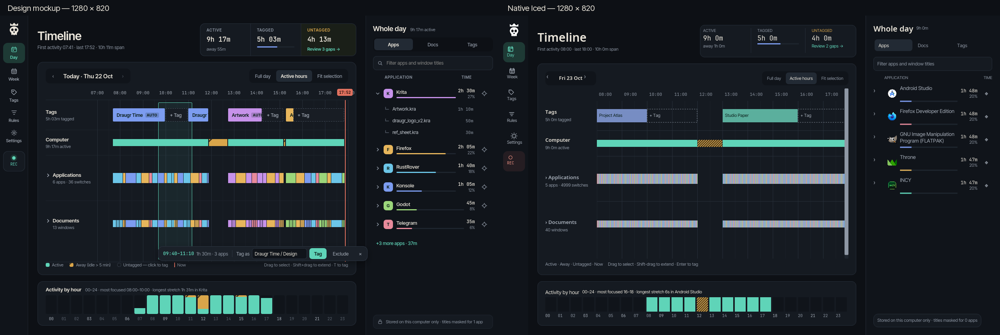
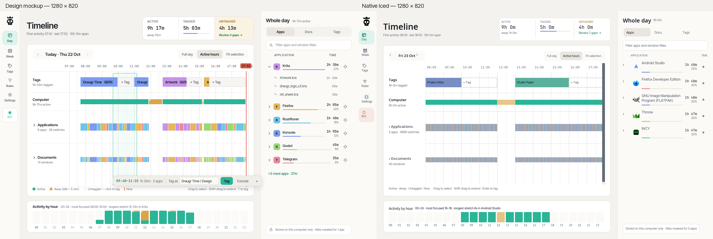

# M12 design slices 1–2 review

The shell redo and Day view use the full design specification, including the
Components / What moves or disappears additions from
[PR #14](https://github.com/hlophlopgaming/DraugrTime/pull/14). Work stops before
Week/Tags/Rules/Settings screen redesigns and the motion pass.

The canonical `day-dark.png` / `day-light.png` names were absent. The supplied
`Day — improved@1x.png` and `Day — improved · light@1x.png` are the reference
artboards. Their pixels are preserved in the comparison images below.

## Desktop comparisons, 1280×820

Each comparison places the supplied artboard on the left and a native Iced
screenshot on the right. The extra 40 px header is outside both screenshots.





| Theme | Native 1280×820 | Native 640×820 | Narrow full-page render |
|---|---|---|---|
| Dark | [Screenshot](screenshots/m12-day-native-dark-1280.png) | [Screenshot](screenshots/m12-day-native-dark-640.png) | [700×1600](screenshots/m12-day-dark-700-full.png) |
| Light | [Screenshot](screenshots/m12-day-native-light-1280.png) | [Screenshot](screenshots/m12-day-native-light-640.png) | [700×1600](screenshots/m12-day-light-700-full.png) |

Selection and lane expansion use the real Iced/tiny-skia renderer headlessly,
with the existing deterministic 5,000-event fixture and bundled fonts:

| State | Dark | Light |
|---|---|---|
| Selection, highlight and expanded app row | [1280×820](screenshots/m12-day-dark-1280-selected.png) | [1280×820](screenshots/m12-day-light-1280-selected.png) |
| Expanded Applications and Documents lanes | [1280×820](screenshots/m12-day-dark-1280-expanded.png) | [1280×820](screenshots/m12-day-light-1280-expanded.png) |
| Narrow viewport | [700×820](screenshots/m12-day-dark-700.png) | [700×820](screenshots/m12-day-light-700.png) |

## Old controls: disposition

| Old control/layout | Result |
|---|---|
| Header Pause / 15 min | Removed. REC opens 5 / 10 / 15 / 30 / 60 minute pauses, Resume now and extensions. |
| Theme button | Settings → General. |
| Quit button | Removed from the window; existing tray Quit remains. |
| Repeated tracking pills | Removed. Rail REC and the tray retain tracking state; error banners remain actionable. |
| Separate ISO date field and Today toolbar | Removed. Compact date navigation and conditional Today are inside the timeline card. |
| Permanent header search | Removed. Ctrl/Cmd+F focuses Day's own panel filter or opens search on other screens. |
| Overview / Reports buttons in the shell | Removed. Day has the hourly card; Week has Open full report. Existing report calculations remain available. |
| Permanent Undo button | Removed. Successful tagging shows a six-second Undo toast; Ctrl/Cmd+Z remains. |
| Four metric cards | Replaced by the single divided summary strip. |
| Repeated right-panel totals | Replaced by Whole day Apps / Docs / Tags, filter, share bars and document expansion. |
| Bottom summary | Moved to the right panel; below the timeline is Activity by hour. |
| Divider and Alt+Up/Down resizing | Removed. Alt+Up/Down now traverses timeline blocks and exposes their details. |
| Pan slider | Removed. Wheel zoom and Shift/horizontal-wheel panning remain. |
| Long diagnostic legend | Replaced by the short legend and hints; individual diagnostic states remain inspectable. |
| Empty midnight-to-first-event span | Active hours is the default; explicit manual zoom/pan survives data refreshes. |

## Deviations from the artboards and their reasons

1. **Data and resulting geometry.** The diagnostic fixture has 5,000 events,
   five applications, two active untagged gaps and different project/document
   names, durations, colors and insight text. Native captures resolve local
   installed application icons. Native REC shows the actual non-recording
   fixture process state rather than pretending that generated history is a
   live recording session. This preserves the existing benchmark and does
   not ship the artboard's sample data or a new demo mode. The deterministic
   selection example uses the same 09:40–11:10 range as the artboard.
2. **Date and Now.** Today is offered only on another date, as PR #14 requires,
   rather than always displaying the artboard's `Today · Thu 22 Oct`. Now is
   drawn only when the real current instant is inside the displayed interval;
   it is not fabricated at 17:52 in a historical fixture screenshot.
3. **Outer spacing.** The main column uses the written 24 px padding; the PNG's
   top summary starts at 20 px. This places the implemented timeline card about
   4 px lower while the full-height card still ends above the same hourly card.
   Rail controls follow the specified 56 px width and 48–52 px height range;
   the bundled logo and locally drawn outline icons have slightly different
   internal silhouettes from the artboard's icon glyphs. Native Iced font/control
   metrics also differ slightly from the artboard's typography.
   The Untagged cell retains neutral surf with amber text and the accent review
   link instead of the PNG's additional tinted fill: the written Day spec calls
   for the amber label and assigns awayDim to away hatching. The legend uses the
   written compact text labels instead of the PNG's tiny colored marker artwork;
   actual away hatching and untagged dashes remain on the tracks.
4. **AUTO badges are not displayed.** Stored tag ranges have no rule-origin
   field. Inferring origin from a matching rule would mislabel manual tags.
   The canvas records this limit; reliable badges need a separately scoped
   provenance migration and tagging changes, not a guessed visual label.
5. **Selection action bar containment.** The bar floats at the bottom right
   inside the timeline card, rather than overhanging into the right panel.
   It wraps at narrow widths and does not shrink the track viewport or hide
   Documents. Tag as uses the existing Iced picker and overlap/tag editor.
   Exclude opens the existing explicit history-deletion confirmation in
   Settings; it is not an invented reversible exclusion category.
6. **Contrast adjustments.** Inactive segment text uses the stronger neutral
   text token on hover, and destructive tint is 5%, to maintain 4.5:1 contrast.
   Ordinary categorical labels use accentInk; custom dark/mid-tone tag colors
   can use white/black fallback ink when required for 4.5:1. Stored colors are
   never rewritten to match the sample palette.
7. **Motion is instantaneous.** Expand/collapse, highlight, selection, date and
   menu transitions intentionally await slice 6. Hover has the specified
   120 ms delay, and there is no new animation subscription or idle tick.
   REC's automatic resume and extensions use the existing backend; a live
   per-second remaining-time presentation is not added in this slice.

The other main screens retain their existing content, with shared components
and required shell-control relocations only. Their trees/editors/section lists,
tray redesign and first-launch dialog belong to subsequent slices.

## Validation and performance

**Final workspace result: 236 passed, 0 failed, 10 ignored.** The explicit
renderer/screenshot test also passed. Ignored tests include the manual
renderer command itself and platform/session-dependent checks.

The complete command output is in [m12-validation.txt](screenshots/m12-validation.txt).

- `cargo fmt --check`
- `cargo clippy --all-targets -- -D warnings`
- `cargo test`
- Explicit headless screenshot/viewport regression test, both themes, wide and
  narrow, selected and expanded states, using 5,000 events.
- Native Wayland smoke and dark/light benchmark captures at 1280×820 and
  640×820, with isolated `/tmp` data/config directories and no personal history.
- Regressions cover rounded active hours, retained manual zoom, independent
  filter/expansion/highlight state, cycling gaps, Whole day totals during
  selection, local hour totals on 23/24/25-hour intervals, keyboard buttons,
  text contrast, selection damage bounds and per-lane subpixel event retention.

A prior native smoke measured a 4.65 ms maximum canvas build. Final per-capture
geometry timings are recorded in [m12-native-results.json](screenshots/m12-native-results.json).
These are debug-build geometry measurements, not end-to-end frame timings.
The normal hidden/loaded-past-day tick-demand tests still pass. There is no new
recurring timer; the Undo toast uses one delayed task, and hourly geometry has
its own cache, invalidated by data/theme/layout changes.

**Not established:** a controlled before/after release CPU/PSS comparison with
`docs/desktop-memory.md`. Observational debug samples released memory after
closing, and one narrow run had unchanged CPU ticks/PSS between 9 and 11 seconds,
but those are not a comparable release baseline. Do not interpret them as proof
of no memory or CPU regression.

During earlier native capture batches two narrow launches timed out before
capturing; retries succeeded. Final capture attempts and failures, if any, are
preserved in the JSON. The cause of the intermittent startup delay was not
established; it is not attributed to the compositor or this change without a
reproduction/trace.

## Manual verification still required

- **Windows/macOS:** launch both themes at 1280×820 and narrow width (including
  high DPI); verify local fonts/icons, Tab/Shift+Tab and F6 focus rings,
  Alt+Up/Down details, expanded lanes, dragging/resizing tags, overlap handling
  and Ctrl/Cmd+Z. Confirm the REC menu pauses and resumes automatically and
  the tray stays synchronized while hidden.
- **Linux X11:** repeat native selection, scrolling, keyboard and tray checks;
  this session's native checks used Wayland.
- **Wayland:** reproduce the intermittent narrow-window startup timeout under
  a clean profile with a trace; manually exercise pointer/keyboard focus and
  pause/automatic resume. Both themes and widths rendered successfully here.
- **Performance:** compare the same release build/profile before and after on
  a loaded past day, while minimized and after closing. Sample CPU/PSS over a
  longer idle interval using the procedure in `docs/desktop-memory.md`.

Reproduce the deterministic screenshots with:

```sh
cargo test -p draugr-time render_day_review_screenshots -- --ignored --test-threads=1 --nocapture
```

For native capture, run the existing `--benchmark --dark` / `--benchmark --light`
flags (add `--narrow` for 640 px) with isolated `XDG_DATA_HOME`, `XDG_CONFIG_HOME`,
`DRAUGR_TIME_DATA_DIR`, and `DRAUGR_TIME_SCREENSHOT` pointing to the output PNG.
